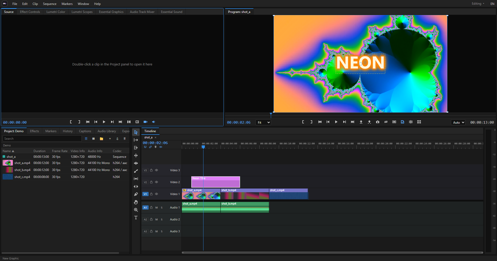
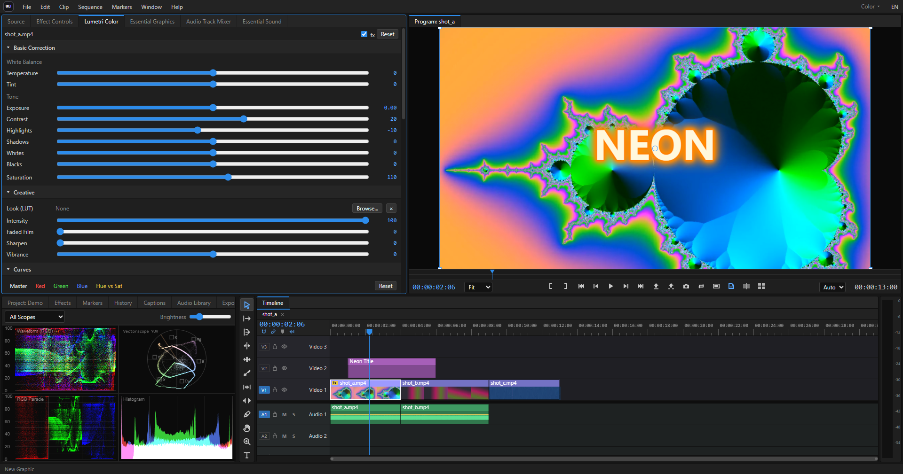
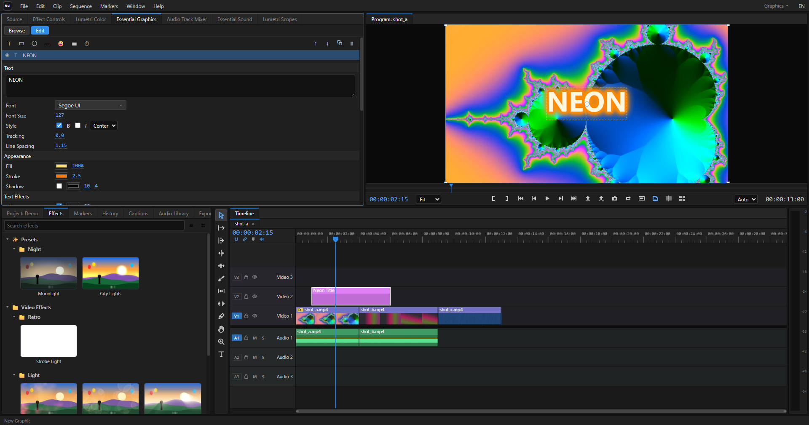
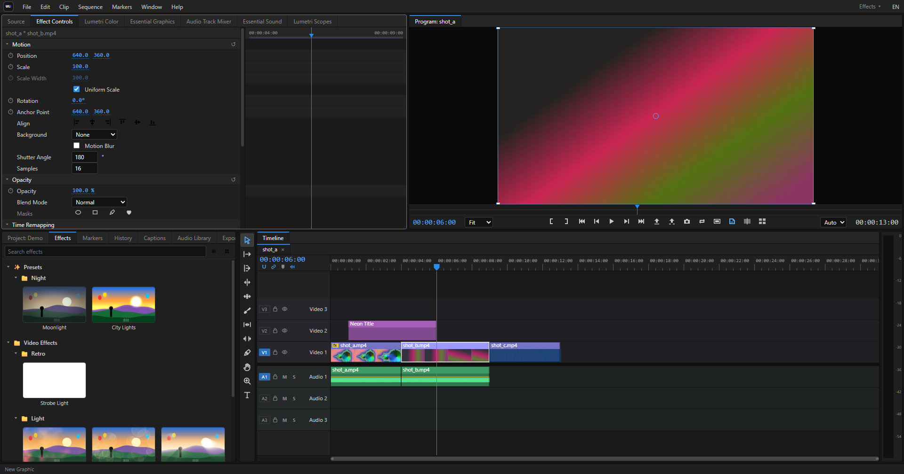

# ULI

**English** | [Türkçe](README.tr.md)

A desktop video editor for Windows that aims to be as clean as Premiere Pro and as rich as CapCut.
Built with Electron, WebGL2 and FFmpeg. The interface is available in English and Turkish.



## Download

Get `ULI Setup x.y.z.exe` from the **Releases** page and run it. The installer adds Start menu and
desktop shortcuts and opens `.ulip` project files on double-click. FFmpeg is included.

> **Windows SmartScreen:** the installer is not code-signed yet, so Windows may show
> "Windows protected your PC". Click **More info** → **Run anyway**.

## Features

**Editing**
- Multi-track timeline with Premiere-style tools: selection, track select, ripple, rolling, rate stretch, razor, slip, slide, pen, hand, zoom, type
- Insert / overwrite, ripple delete, lift / extract, three-point editing from the Source monitor, subclips, markers
- Nested sequences, multi-camera editing with audio sync, scene cut detection, beat detection and cut-to-beat
- Speed / duration, reverse, freeze frame, time remapping with speed ramps and preset speed curves (Montage, Hero, Bullet…)
- Smooth slow motion (frame blending or optical flow) and motion blur
- Keyboard shortcut editor and workspaces (Editing, Color, Effects, Audio, Graphics)

**Effects and color**
- Lumetri Color (basic correction, curves, color wheels, HSL secondary, LUTs) with waveform, parade, vectorscope and histogram
- 50+ effects and 47 transitions, each with a live thumbnail preview; 70+ looks and presets
- Keyframes with a bezier graph editor, masks with tracking, Warp Stabilizer, chroma key



**Text and graphics**
- Essential Graphics with templates, per-character text animations, neon glow, gradients, 3D extrude, text on a curve
- 20 text styles, stickers, emoji, shapes, progress bars, countdowns, captions (SRT/VTT)



**Audio**
- Track mixer, Essential Sound (loudness matching, repair, ducking), audio effects, voice changer
- Built-in sound effect library, text-to-speech (Windows voices), voice-over recording

**Export**
- H.264 / H.265 (NVENC), ProRes, VP9, GIF, PNG sequence, WAV / MP3 / AAC / FLAC
- Preview and export use the same GPU compositor, so what you see is what you get
- One-click presets for YouTube (1080p / 4K), TikTok / Reels / Shorts, Instagram and WhatsApp
- Export queue and preview rendering



## Build from source

Requires Node.js 20+ on Windows.

```
npm install
npm start          # run the app
npm test           # end-to-end tests
npm run dist       # build the Windows installer into dist\
```

The tests start the app with a separate, temporary data folder, so they never touch your real
settings or recent projects. Test videos are generated with FFmpeg into `tests/.media`.

## Roadmap

- Automatic captions (speech-to-text)
- AI tools: background removal, auto reframe
- Code-signed installer and automatic updates
- macOS and Linux builds
- Plugin / extension support

## License

ULI's source code is released under the [MIT License](LICENSE).
The installer also bundles FFmpeg (GPL-3.0) and Electron under their own licenses; see
[THIRD_PARTY_NOTICES.md](THIRD_PARTY_NOTICES.md).
